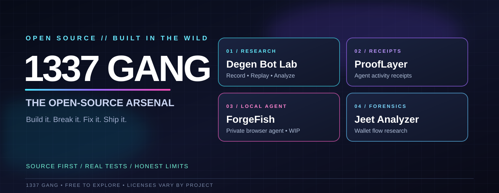

# 1337 GANG / THE ARSENAL

<strong>We ship inspectable tools, publish the source, and show the receipts.</strong> 
Build it. Break it. Fix it. Ship it.

<a href="#start-here">Start here</a> ·
<a href="#the-free-toolkit">Free toolkit</a> ·
<a href="#other-public-work">Other work</a> ·
<a href="#release-standards">Release standards</a>

---

## Start here

**Two developer tools have public, MIT-licensed release branches.** They are available to inspect and run today. Their proposed merges to `main` are still under review. Neither is a token investment, profit claim, or security certification.

| Want to… | Start with | |
| :-- | :-- | :-- |
| Replay market observations without placing trades | **Degen Bot Lab** | [Setup →](1337_GANG_RELEASE.md) |
| Record and inspect the integrity of AI-agent activity claims | **ProofLayer** | [Setup →](https://github.com/unlistedanon/Prooflayer/blob/release/1337-gang-2026-11-19/1337_GANG_RELEASE.md) |

## The free toolkit

<table>
<tr>
<td width="50%" valign="top">
<h3>01 / Degen Bot Lab</h3>

<strong>Record · Replay · Analyze</strong>

Reproducible Python research workflows for public market observations and simulated strategy decisions.

✅ Public release branch · MIT · automated tests

<a href="1337_GANG_RELEASE.md"><strong>Run the tool →</strong></a> · <a href="docs/GETTING_STARTED.md">Documentation</a> · <a href="https://github.com/unlistedanon/degen-bot-lab/pull/2">Release PR</a>

<small>Research only. No live trading, wallet execution, or verified return claims.</small>

</td>
<td width="50%" valign="top">
<h3>02 / ProofLayer</h3>

<strong>Record · Inspect · Verify</strong>

SHA-256 receipts and linked activity history for applications that need to inspect what an AI agent <em>reported</em> doing.

✅ Public release branch · MIT on that branch · automated CI

<a href="https://github.com/unlistedanon/Prooflayer/tree/release/1337-gang-2026-11-19"><strong>Explore the code →</strong></a> · <a href="https://github.com/unlistedanon/Prooflayer/blob/release/1337-gang-2026-11-19/1337_GANG_RELEASE.md">Run locally</a> · <a href="https://github.com/unlistedanon/Prooflayer/pull/3">Release PR</a>

<small>Hash integrity does not prove underlying actions. Public write APIs require security hardening.</small>

</td>
</tr>
</table>

## Other public work

| Project | What it demonstrates | Public availability |
| :-- | :-- | :-- |
| [Jeet Analyzer Colosseum](https://github.com/unlistedanon/jeet-analyzer-colosseum) | Solana wallet-flow investigation and evidence-based exit classification | **Evaluation-only/proprietary** public source; not an MIT reusable toolkit |
| [JOSH Prize Vault public audit](https://github.com/unlistedanon/josh-prize-vault-public-audit) | Prize-vault contracts and transparent review artifacts | Public audit snapshot, **not** an independent security audit |
| [Consciousness Research](https://github.com/unlistedanon/Consciousness-Research) | Exploratory research and hypotheses | Research drafts; no scientific proof claim |
| **ForgeFish** | Local browser automation experiments | Private/local release candidate; **no public installable repo yet** |

## Release standards

- **Reality over screenshots.** A green CI check means automated checks passed on that commit, not that a system is live, profitable, secure against all attacks, or externally validated.
- **Licenses are project-specific.** Publicly readable code is not necessarily open-source code. Check the exact branch and license before reusing anything.
- **Keep the dangerous bits private.** Never publish keys, seed phrases, cookies, session storage, customer/client assets, private recordings, or credentials. See [release security gates](RELEASE_SECURITY_GATE.md).
- **Make feedback useful.** File issues with the exact command, expected behavior, and observed behavior. Small reproducible pull requests are welcome.

---

<strong>1337 GANG</strong> · Free to explore. Designed to be tested. Built to improve.

